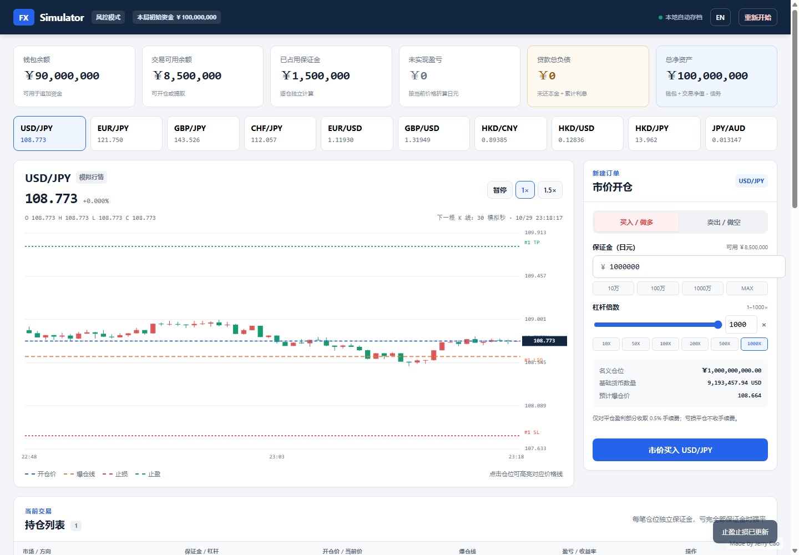

# FX Simulator / 外汇交易模拟器

[English](#english) | [简体中文](#简体中文)

一个纯前端、可离线运行的单人外汇保证金交易模拟游戏。玩家可选择 **30 万至 2 亿日元**作为本局资金，在随机生成的市场中进行多空交易，体验杠杆、逐仓保证金、强平、止盈止损和资金划转。

A browser-based, single-player FX margin trading simulator that works offline. Choose **JPY 300 thousand to 200 million** as starting capital, trade randomly generated markets, and manage leverage, isolated margin, liquidation, optional risk controls, and cash transfers.



> **仅供游戏与学习，不构成投资建议。后续行情全部由程序随机生成，不连接真实交易市场。**  
> **For gaming and educational purposes only. Not investment advice. All subsequent prices are randomly generated and are not connected to live markets.**

---

## 简体中文

### 功能

- **两种开局模式**
  - **经典模式**：仅市价开仓和手动平仓。
  - **风控模式**：市价交易，并可随时添加、修改或取消止盈止损。
  - 模式保存在存档中，局内不可切换；只有完全重新开始才能重新选择。
- **7 档初始资金**：可选 30 万、300 万、1000 万、2000 万、5000 万、1 亿或 2 亿日元，并自由分配钱包与交易账户资金，之后可双向划转。初始投入提供所持有资金 10%、15%、50%、75%、100% 的快捷键。
- **10 个货币市场**：USD/JPY、EUR/JPY、GBP/JPY、CHF/JPY、EUR/USD、GBP/USD、HKD/CNY、HKD/USD、HKD/JPY、JPY/AUD。
- **20 组起始汇率**：每局随机抽取一组真实历史快照作为全部货币对的初始价格。
- **动态 K 线**：正常速度下每秒更新一次，每 30 个模拟秒生成一根新 K 线。
- **随机行情**：不同货币对具有不同波动率，并随机出现上涨、下跌和震荡阶段。各货币对独立生成，不保证交叉汇率一致。
- **多空双向交易**：每笔仓位独立存在，可分别查看和平仓。
- **追加保证金**：选中任意持仓后，可从交易可用余额追加保证金，提供固定金额和 MAX 快捷键；不改变持仓数量，做多强平线下降、做空强平线上升。
- **1–1000 倍杠杆**：按日元保证金开仓，可手动输入或使用 10X、50X、100X、200X、500X、1000X 快捷键；杠杆不与投入金额联动。
- **逐仓强平**：单笔仓位亏完全部保证金时自动强平；图中显示开仓价和爆仓线。
- **止盈止损**：风控模式专属，并在图中显示对应价格线。
- **盈利手续费**：仅对平仓时费前盈利部分收取 0.5%；亏损或持平平仓不收手续费。
- **贷款与债务期限**：未还本金上限按本局初始资金分档；每 120 模拟秒按当前债务复利 10%，每笔贷款须在 600 模拟秒内还清。支持部分或全部还款，到期自动平仓并尝试偿付，不足则游戏结束。若钱包、交易可用余额与全部持仓剩余权益合计低于最低开仓保证金 100 日元且仍有贷款，也会立即结束游戏并弹出提示。
- **游戏结束救助**：在游戏结束画面停留 15 秒现实时间后，会出现“从久留美的父亲那里偷钱”选项。选择后钱包增加 300 万日元并恢复游戏，同时生成一笔不计息、无到期日、还款优先级最低的贷款。该救助每局永久限用一次，即使全部还清也不会重置。
- **资金与贷款快捷键**：资金划转提供固定金额、钱包 MAX 和账户 MAX；借款提供固定金额和额度 MAX；还款提供固定金额和最大可还金额 MAX。
- **时间控制**：正常速度、暂停和 1.5 倍速。1.5 倍速下，约每 0.667 秒更新行情，每 20 秒现实时间生成一根 30 秒模拟 K 线。
- **中英文界面**：可随时切换，不影响游戏模式或存档；金额快捷键在中文显示“万”，英文显示 K/M。
- **交易统计**：胜率、已实现净盈亏、累计手续费、爆仓次数和最近 500 笔平仓记录。
- **本地自动存档**：保存资金、近期 K 线、随机行情状态、持仓、记录、模式和语言设置。
- **退出自动结算**：关闭或刷新页面时，所有未平仓仓位按最后价格自动结算；若浏览器异常退出，下次启动时按最后存档价格补结算。
- **一键重新开始**：二次确认后完全清空资金、持仓、行情、记录和模式，重新选择本局资金与模式。

### 运行

无需安装依赖或构建。

1. 下载或克隆本仓库。
2. 使用最新版 Chrome、Edge、Firefox 或 Safari 打开 `index.html`。
3. 选择游戏模式和初始投入金额，开始游戏。

也可以在项目目录启动本地静态服务器：

```bash
python -m http.server 8000
```

然后访问 `http://localhost:8000`。

> 存档使用浏览器的 `localStorage`，与当前浏览器及页面来源绑定。直接双击文件与通过 HTTP 访问会形成不同存档；清除浏览器数据也会清除存档。

### 操作说明

1. **划转资金**：在“资金划转”面板中，将钱包资金转入交易账户，或将可用交易资金提回钱包。
2. **选择市场**：点击货币对卡片切换图表和交易市场。
3. **开仓**：选择做多或做空，输入保证金与 1–1000 倍杠杆，点击市价开仓按钮。
4. **查看仓位**：持仓列表显示当前盈亏、收益率和爆仓价；点击一行可高亮图中的对应价格线。
5. **追加保证金**：选中持仓后，在“仓位管理”区域输入金额或使用固定金额、MAX 快捷键，降低强平风险。
6. **设置风控**：在风控模式下选中持仓，可添加、修改或清除止盈止损。
7. **平仓**：点击持仓对应“平仓”按钮，立即按当前模拟价格结算。
8. **贷款与还款**：在页面底部“贷款”面板借款，资金进入钱包；可随时部分或全部还款，并查看每笔贷款的计息和到期倒计时。
9. **重新开始**：点击页面右上角“重新开始”，确认后完全清档并重新选择模式。

### 计算规则

对于货币对 `BASE/QUOTE`，所有账户价值最终折算为日元：

```text
报价货币兑日元系数 = 1（QUOTE 为 JPY）
                     当前 USD/JPY（QUOTE 为 USD）
                     当前 HKD/JPY ÷ HKD/CNY（QUOTE 为 CNY）
                     1 ÷ 当前 JPY/AUD（QUOTE 为 AUD）

基础货币数量 = 保证金 × 杠杆 ÷（开仓价 × 报价货币兑日元系数）

费前盈亏 = 方向 ×（当前价 − 开仓价）× 基础货币数量 × 报价货币兑日元系数
方向：做多 = 1，做空 = −1

手续费 = max（费前盈亏，0）× 0.5%
平仓返还 = 保证金 + 费前盈亏 − 手续费
净盈亏 = 费前盈亏 − 手续费
```

- 强平条件：`费前盈亏 ≤ −保证金 × 100%`，即亏完该笔仓位的全部保证金。
- 爆仓价根据当前报价货币换算系数计算；非日元报价货币对的爆仓线可能随换算汇率变化。
- 逐仓仓位最大损失为其当前保证金，不会导致其他仓位或钱包资金被追偿。追加保证金会增加该仓位保证金、不改变基础货币数量，平仓时一并返还剩余保证金。
- 强平按触发时的模拟价格结算，亏损始终以该笔保证金为上限。
- 止盈止损只判断每秒生成的最新价格，不模拟盘中逐笔成交或触发滑点。
- 总净资产 = 钱包余额 + 交易可用余额 + 占用保证金 + 未实现盈亏 − 贷款总负债。
- 贷款当前债务 = 未还本金 + 累计利息；每 120 模拟秒执行 `当前债务 × 1.1`。还款先付利息、再还本金，未还本金减少后会释放借款额度。
- 贷款上限按初始资金分档：30 万 → 300 万；300 万 → 3000 万；1000 万 → 5000 万；2000 万 → 8000 万；5000 万 → 1.5 亿；1 亿 → 5 亿；2 亿 → 10 亿日元。
- 到期时先自动平仓，再以钱包和交易可用余额尝试足额还款；不足则进入游戏结束状态。
- 每次资金变动和行情结算后检查：若 `钱包余额 + 交易可用余额 + 全部持仓剩余权益 < 100 日元` 且贷款总负债大于零，立即进入“资金耗尽”游戏结束状态。持仓剩余权益 = 保证金 + 该仓位未实现盈亏，因此资金占用在持仓中不会被误判为破产。

### 行情数据

游戏内置 **20 组欧洲央行（ECB）历史参考汇率**，日期为：

| 年份 | 日期 |
|---|---|
| 2019 | 2019-01-02、2019-06-03 |
| 2020 | 2020-01-02、2020-06-01 |
| 2021 | 2021-01-04、2021-06-01 |
| 2022 | 2022-01-03、2022-06-01、2022-12-01 |
| 2023 | 2023-06-01、2023-12-01 |
| 2024 | 2024-01-02、2024-06-03、2024-12-02 |
| 2025 | 2025-01-02、2025-02-03、2025-06-02、2025-08-01、2025-10-01、2025-12-01 |

每次开始新游戏时随机选择一组，作为全部 10 个货币对的初始价格。数据通过 [Frankfurter API](https://api.frankfurter.app/2025-01-02?from=EUR&to=USD,JPY,GBP,CHF,HKD,CNY,AUD) 获取，原始基准为 EUR。示例（2025-01-02）：

```json
{"base":"EUR","date":"2025-01-02","rates":{"CHF":0.9371,"CNY":7.5338,"GBP":0.83118,"HKD":8.0261,"JPY":162.04,"USD":1.0321,"AUD":1.6618}}
```

九个初始价格按以下关系换算：

| 货币对 | 换算方式 |
|---|---|
| USD/JPY | EUR/JPY ÷ EUR/USD |
| EUR/JPY | 直接值 |
| GBP/JPY | EUR/JPY ÷ EUR/GBP |
| CHF/JPY | EUR/JPY ÷ EUR/CHF |
| EUR/USD | 直接值 |
| GBP/USD | EUR/USD ÷ EUR/GBP |
| HKD/CNY | EUR/CNY ÷ EUR/HKD |
| HKD/USD | EUR/USD ÷ EUR/HKD |
| HKD/JPY | EUR/JPY ÷ EUR/HKD |
| JPY/AUD | EUR/AUD ÷ EUR/JPY |

只有开局锚点参考上述真实数据。开局前显示的历史 K 线及之后的全部行情均为程序生成，**不是历史真实 K 线，也不是实时行情**。游戏不模拟买卖价差、滑点、隔夜利息、市场休市、挂单或真实成交量。

### 测试

需要 Node.js 18 或更高版本：

```bash
npm test
npm run check
npm run test:ui
```

测试覆盖资金守恒、开仓、多空盈亏、0.5% 盈利手续费、汇率换算、爆仓价、自动强平、止盈止损、资金划转、贷款额度、复利计息、还款、到期偿付、债务违约、20 组快照、JPY/AUD 换算、追加保证金、救助贷款、K 线生成、退出结算和统计。`test:ui` 使用本机 Chrome 执行页面检查并生成 `screenshot.png`；默认路径为 Windows 版 Chrome，也可通过 `CHROME_PATH` 环境变量指定其他 Chrome 可执行文件。

### 项目结构

```text
FX/
├── index.html            # 页面结构
├── styles.css            # 响应式界面样式
├── js/
│   ├── data.js           # 货币对、初始价格和游戏常量
│   ├── engine.js         # 行情、仓位、盈亏、强平和结算逻辑
│   └── app.js            # 界面、图表、交互、双语和本地存档
├── tests/
│   ├── engine.test.js    # 无依赖的 Node.js 单元测试
│   └── browser-smoke.js  # Chrome 页面交互检查
├── screenshot.png         # 实际运行截图
├── package.json          # 测试与语法检查命令
└── README.md
```

### 技术说明与限制

- 使用原生 HTML、CSS、JavaScript 和 Canvas，无运行时第三方依赖。
- 这是交易模拟游戏，不是真实交易平台，也不保证随机模型具有真实金融市场的统计性质。
- 页面关闭和刷新都会触发退出结算。浏览器崩溃时可能丢失最近一次定时存档之后的少量变化。
- 所有数据仅保存在本机浏览器中，不上传服务器。

---

## English

### Features

- **Two modes selected at the start**
  - **Classic:** market orders and manual closing only.
  - **Risk control:** market trading plus optional stop-loss and take-profit levels that can be added, edited, or cleared at any time.
  - The mode is saved and locked for the current run. A full restart is required to change it.
- **Seven starting-capital choices:** JPY 300K, 3M, 10M, 20M, 50M, 100M, or 200M, with an adjustable wallet/trading allocation and later transfers in either direction. Initial-deposit shortcuts select 10%, 15%, 50%, 75%, or 100% of the chosen capital.
- **Ten markets:** USD/JPY, EUR/JPY, GBP/JPY, CHF/JPY, EUR/USD, GBP/USD, HKD/CNY, HKD/USD, HKD/JPY, and JPY/AUD.
- **Twenty starting-rate snapshots:** each run randomly selects one real historical snapshot for all initial prices.
- **Live candlestick chart:** at normal speed, prices update every second and a new candle forms every 30 simulated seconds.
- **Random markets:** each pair has its own volatility and random upward, downward, or sideways phases. Pairs evolve independently, so cross-rate consistency is not enforced.
- **Long and short positions:** every position is independent and can be inspected or closed separately.
- **Additional margin:** select any position to add margin from available trading cash using fixed shortcuts or MAX. Position units remain unchanged; long liquidation moves down and short liquidation moves up.
- **1–1000× leverage:** enter leverage manually or use 10X, 50X, 100X, 200X, 500X, and 1000X shortcuts. Leverage is never linked automatically to the margin amount.
- **Isolated liquidation:** a position is liquidated only after its full margin is lost. Entry and liquidation levels are drawn on the chart.
- **Optional SL/TP:** available in risk control mode and displayed on the chart.
- **Profit-only fee:** 0.5% of positive gross P&L at closing; no fee on losing or break-even exits.
- **Loans and maturity:** the outstanding-principal limit is tiered by starting capital. Current debt compounds by 10% every 120 simulated seconds, and each loan matures after 600 simulated seconds. Supports partial/full repayment, automatic position settlement and repayment at maturity, and game over on insufficient cash. The game also ends immediately with a popup when wallet, available trading cash and all open-position equity total less than the JPY 100 minimum opening margin while debt remains.
- **Game-over rescue:** after 15 real seconds on the game-over screen, a “Steal money from Kurumi's father” option appears. It adds JPY 3M to the wallet and resumes play while creating an interest-free loan with no maturity and the lowest repayment priority. The rescue is permanently limited to once per run and is not restored after repayment.
- **Cash and loan shortcuts:** transfers offer fixed amounts, Wallet MAX and Trading MAX; borrowing offers fixed amounts and Credit MAX; repayment offers fixed amounts and a maximum affordable repayment MAX.
- **Time controls:** normal speed, pause, and 1.5× speed. At 1.5×, prices update about every 0.667 seconds and a 30-second simulated candle forms every 20 real seconds.
- **Chinese/English UI:** switch at any time without changing the mode or save. Quick amounts use 万 in Chinese and K/M in English.
- **Trading statistics:** win rate, realized net P&L, total fees, liquidation count, and up to 500 closed-trade records.
- **Local autosave:** funds, recent candles, market state, positions, records, mode, and language are stored locally.
- **Settlement on exit:** closing or refreshing the page settles all positions at the latest price. After an abnormal exit, the next launch reconciles saved positions at their last saved prices.
- **Full restart:** after confirmation, clears all progress and returns to starting-capital and mode selection.

### Run locally

No installation or build step is required.

1. Download or clone this repository.
2. Open `index.html` in a current version of Chrome, Edge, Firefox, or Safari.
3. Select a mode and initial deposit to start.

Alternatively, serve the directory locally:

```bash
python -m http.server 8000
```

Then visit `http://localhost:8000`.

> Saves use `localStorage` and are scoped to the browser and page origin. Opening the file directly and using HTTP creates different saves. Clearing browser site data also removes the save.

### How to play

1. **Transfer funds:** move money from the wallet to the trading account or withdraw available trading cash.
2. **Select a market:** click a currency-pair card to change the chart and order market.
3. **Open a position:** choose long or short, enter margin and 1–1000× leverage, then submit the market order.
4. **Inspect positions:** the table shows P&L, ROE, and liquidation price. Select a row to highlight its chart levels.
5. **Add margin:** use the position-management editor with a custom amount, fixed shortcuts, or MAX to reduce liquidation risk.
6. **Manage risk:** in risk control mode, select a position to add, edit, or clear its stop-loss and take-profit.
7. **Close:** use the position's Close button for immediate settlement at the current simulated price.
8. **Borrow and repay:** use the Loans panel at the bottom. Borrowed funds enter the wallet; make partial or full repayments and monitor interest and maturity countdowns for each loan.
9. **Restart:** use Restart in the header and confirm to erase the run and select a new mode.

### Calculation rules

For a `BASE/QUOTE` pair, all account values are converted to JPY:

```text
Quote-to-JPY conversion = 1 when QUOTE is JPY
                          current USD/JPY when QUOTE is USD
                          current HKD/JPY ÷ HKD/CNY when QUOTE is CNY
                          1 ÷ current JPY/AUD when QUOTE is AUD

Base units = margin × leverage ÷ (entry price × quote-to-JPY conversion)

Gross P&L = direction × (current price − entry price) × base units × conversion
Direction = 1 for long, −1 for short

Fee = max(gross P&L, 0) × 0.5%
Returned cash = margin + gross P&L − fee
Net P&L = gross P&L − fee
```

- Liquidation condition: `gross P&L ≤ −margin × 100%`, meaning the position's full margin has been lost.
- Liquidation price uses the current quote-currency conversion. For non-JPY-quoted pairs, it can move as the conversion rate changes.
- Loss is capped at each position's current isolated margin; other positions and wallet funds are not used to cover it. Additional margin increases that position's margin without changing base units, and remaining margin is returned at closing.
- Liquidation fills at the triggering simulated price, and loss remains capped at that position's margin.
- SL/TP checks use each one-second price update and do not model tick-by-tick execution or slippage.
- Total net worth = wallet + available trading cash + margin in use + unrealized P&L − total loan debt.
- Current loan debt = outstanding principal + accrued interest. Every 120 simulated seconds, current debt is multiplied by 1.1. Repayments cover interest before principal; principal repayments release borrowing capacity.
- Loan limits by starting capital: JPY 300K → 3M; 3M → 30M; 10M → 50M; 20M → 80M; 50M → 150M; 100M → 500M; 200M → 1000M.
- At maturity, positions are closed automatically and full repayment is attempted using wallet and available trading cash. Insufficient cash ends the run.
- After every cash change and market settlement: if `wallet + available trading cash + all open-position equity < JPY 100` while total loan debt is positive, the game immediately ends with a funds-exhausted popup. Position equity equals margin plus unrealized P&L, so funds held in open positions are included in the bankruptcy check.

### Market data

The game includes **20 sets of European Central Bank historical reference rates**, dated:

| Year | Dates |
|---|---|
| 2019 | 2019-01-02, 2019-06-03 |
| 2020 | 2020-01-02, 2020-06-01 |
| 2021 | 2021-01-04, 2021-06-01 |
| 2022 | 2022-01-03, 2022-06-01, 2022-12-01 |
| 2023 | 2023-06-01, 2023-12-01 |
| 2024 | 2024-01-02, 2024-06-03, 2024-12-02 |
| 2025 | 2025-01-02, 2025-02-03, 2025-06-02, 2025-08-01, 2025-10-01, 2025-12-01 |

Each new game randomly selects one set as the starting anchor for all ten pairs. Data was obtained through the [Frankfurter API](https://api.frankfurter.app/2025-01-02?from=EUR&to=USD,JPY,GBP,CHF,HKD,CNY,AUD), using EUR as the source base. Example (2025-01-02):

```json
{"base":"EUR","date":"2025-01-02","rates":{"CHF":0.9371,"CNY":7.5338,"GBP":0.83118,"HKD":8.0261,"JPY":162.04,"USD":1.0321,"AUD":1.6618}}
```

| Pair | Derivation |
|---|---|
| USD/JPY | EUR/JPY ÷ EUR/USD |
| EUR/JPY | Direct rate |
| GBP/JPY | EUR/JPY ÷ EUR/GBP |
| CHF/JPY | EUR/JPY ÷ EUR/CHF |
| EUR/USD | Direct rate |
| GBP/USD | EUR/USD ÷ EUR/GBP |
| HKD/CNY | EUR/CNY ÷ EUR/HKD |
| HKD/USD | EUR/USD ÷ EUR/HKD |
| HKD/JPY | EUR/JPY ÷ EUR/HKD |
| JPY/AUD | EUR/AUD ÷ EUR/JPY |

Only the starting anchor references these real rates. The candles displayed at the start and every subsequent price are procedurally generated: **they are neither historical candles nor live prices**. The simulator does not model spreads, slippage, swaps, market closures, pending orders, or real volume.

### Tests

Node.js 18 or newer is required:

```bash
npm test
npm run check
npm run test:ui
```

The tests cover capital conservation, order placement, long/short P&L, the 0.5% profit fee, FX conversion, liquidation prices, automatic liquidation, SL/TP, transfers, loan limits, compound interest, repayment, maturity settlement, debt default, 20 snapshots, JPY/AUD conversion, additional margin, rescue loans, candle creation, session settlement, and statistics. `test:ui` uses local Chrome for browser checks and generates `screenshot.png`. Its default executable path targets Chrome on Windows; set the `CHROME_PATH` environment variable to use another Chrome executable.

### Project structure

```text
FX/
├── index.html            # Page structure
├── styles.css            # Responsive UI
├── js/
│   ├── data.js           # Pairs, initial prices, and game constants
│   ├── engine.js         # Markets, positions, P&L, liquidation, settlement
│   └── app.js            # UI, chart, interactions, i18n, and local saves
├── tests/
│   ├── engine.test.js    # Dependency-free Node.js unit tests
│   └── browser-smoke.js  # Chrome interaction checks
├── screenshot.png         # Actual application screenshot
├── package.json          # Test and syntax-check commands
└── README.md
```

### Technical notes and limitations

- Built with vanilla HTML, CSS, JavaScript, and Canvas; no runtime third-party dependencies.
- This is a trading game, not a brokerage platform. Its random model is not intended to reproduce real financial-market statistics.
- Both closing and refreshing the page trigger session settlement. A browser crash may lose changes since the latest periodic save.
- All data stays in the local browser and is never uploaded.
